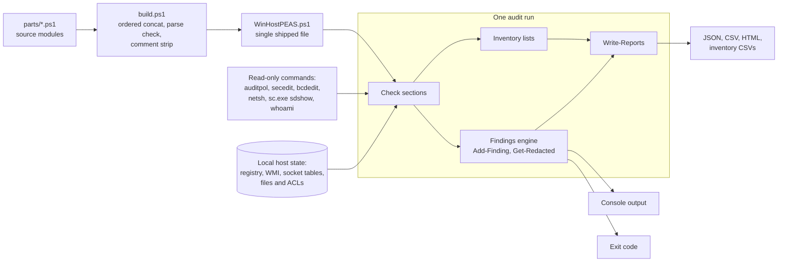
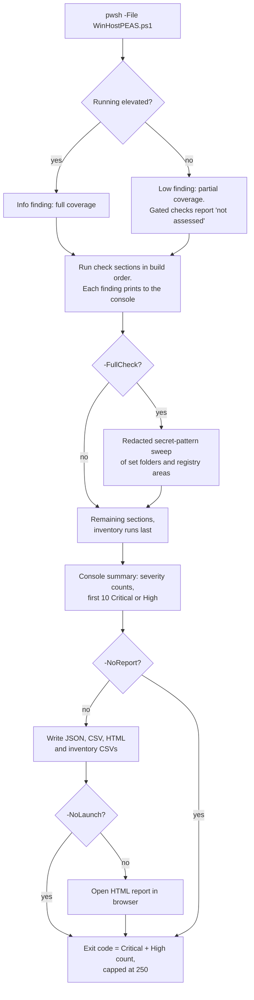
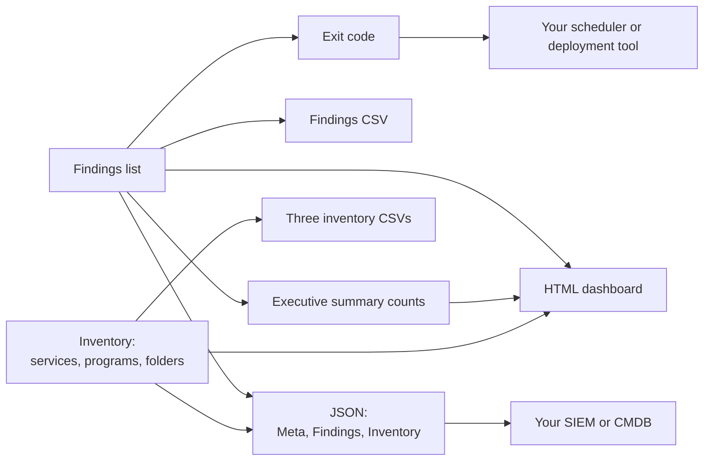

# WinHostPEAS: read-only Windows security posture audit in PowerShell

WinHostPEAS is a read-only PowerShell script that audits the security posture of one Windows host, written for blue teams, sysadmins and image builders.

It is a blue-team refit of [winPEAS.ps1](https://github.com/peass-ng/PEASS-ng) (PEASS-ng / @RandolphConley). It walks the same ground an attacker would enumerate after landing on a host, on Windows Server 2019/2022/2025 and Windows 10/11, including a deep IIS audit. Each check produces a finding with a severity and a fix, where winPEAS would print an exploit path. Secrets are detected and redacted, and the results are written as JSON, CSV and an HTML dashboard that suit unattended fleet runs. No offensive tooling is retained.



## Contents

- [What it guarantees](#what-it-guarantees)
- [How it differs from winPEAS](#how-it-differs-from-winpeas)
- [How to run it](#how-to-run-it)
- [Output formats](#output-formats)
- [What it checks](#what-it-checks)
- [Hardening a golden image](#hardening-a-golden-image)
- [Unattended fleet deployment](#unattended-fleet-deployment)
- [FAQ](#faq)
- [Building from source](#building-from-source)

## What it guarantees

### It sends nothing

Every check reads local state only: registry, WMI, local socket tables, local files. There are no ICMP sweeps, port scans or banner grabs, and no LDAP or NTP queries. Nothing is sent to a domain controller. Domain membership comes from `Win32_ComputerSystem`. The external binaries it shells out to are all read-only verbs: `auditpol /get`, `secedit /export`, `bcdedit /enum`, `netsh ... show`, `sc.exe sdshow`, `whoami /priv`, `whoami /groups`, `cmdkey /list` (entries counted, never printed).

### It changes nothing

The script makes no registry writes, no service or policy changes and no ACL edits. It writes its own reports to `-OutputDir` and one temporary secedit export to `%TEMP%`, which it then deletes. Remediation text tells you what to change. The tool never changes it for you.

You can check both by grepping the single shipped script, so you do not have to take this README's word for it.

## How it differs from winPEAS

winPEAS answers "how do I escalate from here?" WinHostPEAS answers "what would an attacker find if they landed here, and how do I close it first?"

| | winPEAS.ps1 | WinHostPEAS |
|---|---|---|
| Output | Console dump | Structured findings (Severity/Category/Remediation) |
| Secrets | Prints passwords, WiFi keys, DPAPI blobs | Detects and redacts; values never reach console or report |
| Guidance | "Try mimikatz" | Fix instructions, MITRE technique IDs, IEC 62443 / CIS references |
| AV | Defender-flagged, AMSI-blocked | Runs clean with realtime protection on |
| Network | Active scanning | Nothing sent, local reads only |
| Unattended | No | Exit code = Critical+High count |

## How to run it

```powershell
# Fast posture audit
pwsh -File WinHostPEAS.ps1 -OutputDir .\WinHostPEAS_Output

# Deep run: adds a scoped, redacted secret-pattern sweep
pwsh -File WinHostPEAS.ps1 -OutputDir \\server\share\audits -FullCheck -TimeStamp
```

| Switch | Effect |
|---|---|
| `-FullCheck` | Adds a redacted secret-pattern sweep of credential-bearing directories and registry areas |
| `-OutputDir <path>` | Report destination (default `.\WinHostPEAS_Output`); use a UNC path to collect reports from a fleet in one place |
| `-TimeStamp` | Per-section elapsed-time stamps |
| `-NoReport` | Console only, no files written |
| `-NoLaunch` | Do not open the HTML dashboard; use this for unattended runs |
| `-Obfuscate` | Randomized report filenames and a generic tool label |

Reference runtimes on a Windows 11 workstation with a few hundred programs installed: about 80 seconds by default (the inventory adds about 10), longer with `-FullCheck`.



### Run it elevated

The tool works as a standard user, but about a dozen checks need administrator: audit policy, the secedit baseline, boot configuration, Security event log settings, BitLocker, WMI event subscriptions, connectivity history, the scheduled-task file baseline, and other users' process details.

When a check cannot run, WinHostPEAS says so. It emits an explicit "not assessed (needs elevation)" finding and does not report a clean result. A check that could not execute must never look like a check that found nothing wrong, and much of the design follows from that rule. A banner at the top of every run states which context it ran in.

If you audit only non-elevated, expect partial coverage, and read the "not assessed" findings as gaps, not passes.

## Output formats

Every check funnels into one collector. Each finding carries `Timestamp, Host, Severity (Critical/High/Medium/Low/Info), Category, Title, Detail, Evidence, Remediation`.

| Output | File | Contents |
|---|---|---|
| Console | none | One line per finding with detail and fix, then severity counts and the first 10 Critical or High items |
| JSON | `WinHostPEAS_<HOST>_<timestamp>.json` | A `Meta` block, the `Findings` array, and the three lists under `Inventory` |
| CSV | `WinHostPEAS_<HOST>_<timestamp>.csv` | One row per finding |
| HTML | `WinHostPEAS_<HOST>_<timestamp>.html` | Dashboard with severity tiles, text search, a category filter, an executive summary and filterable inventory tables |
| Inventory CSVs | `..._inventory_services.csv`, `..._inventory_software.csv`, `..._inventory_folders.csv` | Services, installed programs and program folders |
| Exit code | none | Count of Critical and High findings, capped at 250 |

With `-Obfuscate`, the files are named `rpt_<random>_<timestamp>` and the tool label in the report becomes "Posture Audit".



### Handle the reports carefully

Reports enumerate credential-adjacent material: paths, account names, exclusion lists, listening services. Secret values are redacted, but the reports still describe your attack surface in detail. Treat them as evidence, not as logs. The supplied `.gitignore` excludes report artifacts for that reason.

The tool offers no encryption of its own, on purpose. Protect reports at the storage layer: write to a share with real access controls, or to a BitLocker or EFS-protected volume. A passphrase switch on a scanner would get more trust than it has earned.

## What it checks

| Area | Examples of what is inspected | Source |
|---|---|---|
| Defender and AV posture | Realtime status, Tamper Protection, exclusions, signature age | `parts/20_system.ps1` |
| Logging and detection coverage | Audit policy, command-line capture, PowerShell logging, event forwarding | `parts/20_system.ps1` |
| Credential exposure | WDigest, LSA Protection, Credential Guard, answer files, stored keys | `parts/21_creds.ps1` |
| Privilege escalation | Service DACLs and binaries, unquoted paths, `PATH` folders, UAC | `parts/22_privesc.ps1` |
| Privilege escalation paths | Privileged group membership, user rights, phantom DLLs, privileged tasks, stored credentials, relay preconditions | `parts/37_privesc_paths.ps1` |
| Network attack surface | SMBv1 and signing, LLMNR/NBT-NS, RDP NLA, listening ports, shares | `parts/23_network.ps1` |
| Account hygiene and identity | Password policy, local admins, LAPS, BitLocker, NTLM policy | `parts/23_network.ps1`, `parts/24_ad_software.ps1` |
| Passive network visibility | ARP and neighbour cache, established connections | `parts/25_ot_discovery.ps1` |
| Service and OT inventory | Listeners by process, BMS/OT protocol ports, vendor software | `parts/26_service_inventory.ps1` |
| Loopback and tunnels | Loopback listeners, `netsh portproxy`, SSH tunnels | `parts/27_loopback.ps1` |
| IIS and web server | Sites, app pools, web.config, certificates, WinRM | `parts/28_iis.ps1` |
| OS and crypto surface | Build support status, SCHANNEL, cipher suites, secedit baseline | `parts/29_os_vulns.ps1` |
| Persistence | Winlogon, WMI subscriptions, COM hijacks, IFEO, LSA packages | `parts/30_hardening.ps1`, `parts/33_advanced.ps1`, `parts/34_btfm_expansion.ps1` |
| Image hardening baseline | ASR rules, application control, SmartScreen, Exploit Protection | `parts/30_hardening.ps1` |
| Connectivity history | Past networks, WiFi profiles, DNS cache, RDP and SSH history | `parts/32_history.ps1` |
| Security features | EDR presence, VBS and HVCI, Secure Boot, Sysmon | `parts/35_security_features.ps1` |
| Asset inventory | Services, installed programs, program folders | `parts/36_inventory.ps1` |

### Secret detection without secret exposure

The winPEAS regex corpus (cloud keys, GitHub/GitLab tokens, JWTs, private-key blocks, connection strings, and more) is kept for detection only. Matches are recorded with the value replaced by a fingerprint such as `<redacted:52ch, ends ...Xy9a>`. Removed outright: WiFi password dumps, clipboard printing, PasswordVault dumping, DPAPI decryption, history echoing. You learn that a secret exists and where it lives. That is enough to rotate it, and too little to leak it from a report left on a share.

### Credential exposure

WDigest plaintext storage, LSA Protection (RunAsPPL), Credential Guard running state (from `Win32_DeviceGuard`, since it is on by default on newer Windows with no registry value), cached logon count, AutoAdminLogon passwords (redacted), PuTTY stored proxy passwords, ssh-agent keys, unattend and sysprep answer files, cloud CLI credential files, SAM/SYSTEM hive copies.

### Privilege escalation

AlwaysInstallElevated, unquoted service paths, weak ACLs on service binaries and service registry keys, user-writable startup items, dangerous token privileges held by the caller (SeImpersonate, SeDebug, SeBackup), PointAndPrint policy, WSUS over HTTP, writable scheduled-task actions.

Service DACLs are read with `sc.exe sdshow` and flagged when a low-privilege principal can change the service configuration, DACL or owner (Critical when the service runs as LocalSystem; start and stop rights alone are not escalation). Service binaries in user-writable folders or unsigned, svchost `ServiceDll` entries outside System32, writable machine `PATH` folders ahead of System32, writable Program Files subfolders and running process binaries are all checked by ACL.

Every permission check works by SID against low-privilege principals (Everyone, Users, Authenticated Users, INTERACTIVE and similar, plus the running user only when not elevated), so results are the same in any Windows language and do not depend on who runs the audit. Deny and inherit-only entries are skipped.

UAC coverage distinguishes *EnableLUA absent* from *EnableLUA = 0*, because a deleted value implies tampering and calls for different remediation. It also flags silent-elevation consent and `LocalAccountTokenFilterPolicy = 1`, the setting that makes pass-the-hash work against admin shares.

### Privilege escalation paths

The escalation paths seen most often in real intrusions and red-team engagements (MITRE ATT&CK TA0004, the PayloadsAllTheThings and HackTricks Windows checklists), and where each one is checked. Every check is a passive local read.

| Path | What is checked | Source |
|---|---|---|
| Local Administrators | Direct members, local groups nested inside it (expanded one level), directory groups other than Domain Admins, directory users, broad principals (Everyone, Users, Domain Users and similar), orphaned SIDs. Directory groups are listed, not expanded, because that needs a DC query | `37_privesc_paths.ps1` |
| Built-in Administrator (RID 500) | Enabled, not renamed | `23_network.ps1` |
| Other privileged local groups | Backup, Server, Print and Account Operators, Hyper-V and Storage Replica Administrators, Network Configuration Operators, Remote Desktop Users, Remote Management Users, Event Log Readers, Distributed COM Users, Performance Log Users, Cryptographic Operators, DnsAdmins, docker-users | `37_privesc_paths.ps1` |
| The audit account's own groups | Split-token administrator, membership of admin-equivalent groups, Domain/Schema/Enterprise Admins SIDs | `37_privesc_paths.ps1` |
| Token privileges of the running account | SeImpersonate, SeAssignPrimaryToken (Potato family), SeBackup, SeRestore, SeDebug, SeTakeOwnership, SeLoadDriver, SeManageVolume, SeTcb, SeCreateToken, SeRelabel, SeTrustedCredManAccess | `22_privesc.ps1` |
| User-rights assignment (elevated) | Non-default holders of the same privileges, from the secedit export | `37_privesc_paths.ps1` |
| Potato-family exposure | Network-facing services (IIS, SQL Server, Tomcat and similar) running as accounts that hold SeImpersonate | `37_privesc_paths.ps1` |
| Services | Unquoted paths, writable binaries, folders and registry keys, service DACLs (SDDL), svchost ServiceDll | `22_privesc.ps1` |
| AlwaysInstallElevated | Both hives (Critical) or one hive (Medium) | `22_privesc.ps1` |
| `PATH` and DLL hijack | Writable machine and user `PATH` folders, SafeDllSearchMode, KnownDLLs; phantom DLLs loaded by SYSTEM services (wlbsctrl, WptsExtensions, cdpsgshims, TSMSISrv, TSVIPSrv), both planted copies and open hijack slots | `34_btfm_expansion.ps1`, `37_privesc_paths.ps1` |
| Scheduled tasks | Writable executables of non-Microsoft tasks; for tasks running as SYSTEM, a service account, the Administrators group or with highest privileges: writable action folders, missing action binaries and writable script arguments | `22_privesc.ps1`, `37_privesc_paths.ps1` |
| Autoruns | Writable startup-folder items; writable HKLM Run targets and writable Run keys | `22_privesc.ps1`, `37_privesc_paths.ps1` |
| Stored credentials | Autologon, unattend and sysprep files, Credential Manager counts, runas /savecred and saved RDP entries (counts only), GPP `cpassword`, SAM hive copies, HiveNightmare ACL | `21_creds.ps1`, `22_privesc.ps1`, `37_privesc_paths.ps1` |
| UAC | EnableLUA, ConsentPromptBehaviorAdmin, LocalAccountTokenFilterPolicy, secondary CIS values | `22_privesc.ps1` |
| LAPS | Legacy and Windows LAPS, gated on join state | `23_network.ps1` |
| WSUS | Update server over HTTP | `22_privesc.ps1` |
| PrintNightmare | Point and Print policy, Spooler exposure by role | `22_privesc.ps1` |
| Relay preconditions (KrbRelayUp and similar) | LDAP client signing; LDAP server signing and channel binding on a DC; WebClient service. MachineAccountQuota and DC-side signing on other hosts need a DC query and are out of scope | `37_privesc_paths.ps1` |
| Vulnerable drivers (BYOVD) | Running drivers against the LOLDrivers name list and by signature; Microsoft driver blocklist, HVCI | `34_btfm_expansion.ps1`, `35_security_features.ps1` |
| Software with a known LPE | Short watchlist (OpenVPN, TeamViewer, VMware Tools) by fixed version; not a vulnerability scanner | `37_privesc_paths.ps1` |
| Named pipes | Pipe names matching post-exploitation and remote-execution tool defaults. Pipe DACLs are not read, because opening a pipe is a client connection | `37_privesc_paths.ps1` |
| WSL | Registered distributions in loaded user hives | `37_privesc_paths.ps1` |

### Defender and AV posture

Realtime status, Tamper Protection, running mode (normal, passive or EDR block mode), signature freshness, scan recency, and a full exclusion inventory. Attackers add exclusions early, so the list matters. A standard user only sees a subset of them, so a non-elevated run labels the count PARTIAL and does not present it as complete.

### Logging and detection coverage

auditpol subcategories read by GUID (so the parse is not tied to an English display name), process-creation command-line capture, Security event log sizing, Windows Event Forwarding, and PowerShell ScriptBlock/Module/Transcription logging gaps.

### Security features and detection coverage

Third-party AV and EDR presence (Security Center plus a table of known EDR services), Microsoft Defender for Endpoint onboarding, VBS and HVCI (Memory Integrity) running state from `Win32_DeviceGuard`, Secure Boot, the Microsoft vulnerable driver blocklist, NTLM session security and restriction settings against CIS, the mDNS and WPAD legs of the Responder poisoning chain, Sysmon (by its filter altitude, so a renamed driver is still found) and log-forwarding agents. A host with no Sysmon, no EDR and no forwarding gets a single "host telemetry gap" finding.

### Network attack surface

SMBv1 and SMB signing, LLMNR/NBT-NS, RDP NLA and SecurityLayer, listening-port inventory with risky-classic flags, hosts-file overrides, WPAD, world-writable shares. Port visibility comes from the local socket table, not from scanning.

### Passive network visibility

ARP and neighbour cache plus established-connection inventory, with MAC-OUI vendor tagging. This shows who the host already talks to. Nothing is probed.

### Connectivity history

Networks the host has joined before (from the NetworkList registry keys, which need elevation), saved WiFi profile names, the DNS resolver cache, RDP servers previously connected to, PuTTY sessions and SSH `known_hosts`, static routes, mapped drives and recent UNC paths, and custom inbound firewall allow rules.

### Service and OT inventory

Local listeners mapped to owning process and binary version, against a port dictionary covering IT services and BMS/OT protocols (Modbus/TCP 502, BACnet 47808, EtherNet/IP 44818, OPC-UA 4840/4843, DNP3 20000, Niagara Fox, Omron FINS, CoDeSys). OT listeners are flagged with IEC 62443 SR 5.1 zone and conduit remediation. Installed software is matched against a BMS vendor dictionary so controller and HMI software is versioned for CVE watchlisting.

### Asset inventory

Three lists, written as separate CSV files next to the findings and shown as filterable tables at the bottom of the HTML report (and under `Inventory` in the JSON):

- Services: every service with state, start mode, account, binary path, and the binary's company and version.
- Installed programs: the 64-bit and 32-bit Uninstall keys plus every loaded user hive, so per-user installs (which skip admin approval) are included and labeled with their owner.
- Program folders: every top-level folder under Program Files and Program Files (x86), plus the ProgramData and user AppData (`Local`, `Local\Programs`, `Roaming`) folders that hold real executables. Installer and updater stubs do not count, and each folder is named by its largest executable.

Findings summarize the lists and point at what deserves a look: third-party services, services running from ProgramData or a user profile, per-user installs, programs living in AppData, and folders whose programs never registered an uninstall entry (portable tools and leftovers that patch tooling cannot see). Other users' AppData is only readable elevated; a non-elevated run names the profiles it skipped.

### Loopback and tunnel detection

Loopback-bound listeners with owning process, loopback conversations, `netsh portproxy` rules (classic T1090 relay persistence), SSH/plink `-L/-R/-D` tunnels, DNS terminating on loopback, hosts-file redirection, proxy bypass config.

### Account hygiene and identity

Accounts carrying the `PASSWD_NOTREQD` flag, password policy, never-expiring passwords, local admin inventory, LAPS presence, BitLocker, screen-lock timeout. Domain-joined hosts also get NTLM policy and ADCS ESC10 Schannel UPN mapping, both read from the local registry.

The blank-password check needs explaining, because the obvious version of it is wrong. `PASSWD_NOTREQD` means a blank password is *permitted*, not that the account has one, and the flag is a routine artifact of programmatic account creation. Reporting it as "no password" raises a false alarm on ordinary service accounts. Confirming the real state would mean attempting authentication, which writes failed-logon events and can trip lockout policy, so the tool does not do it. It reports the flag accurately and scales severity by `LimitBlankPasswordUse`, since a blank password that cannot be used over the network is a much smaller problem than one that can.

Domain-side hygiene such as Kerberoastable SPNs and gMSA read permissions is not assessed, because every way to check it means querying a domain controller.

### Patch posture

Hotfix recency and pending-reboot detection.

### IIS and web server

Read-only inventory via `Microsoft.Web.Administration`: sites and bindings, app pool identities, web-root writability, certificate expiry and weak signatures, URL Rewrite version currency. The web.config sweep looks for plaintext connection-string passwords, weak machineKey validation, directory browsing, and `retail=false`. applicationHost.config checks for Basic-auth-over-HTTP, and raises a Critical if the file itself is user-writable. WinRM transport and auth are covered too, including service state and listening ports when the listener config is unreadable.

### OS and crypto surface

Build and end-of-support status, SCHANNEL protocol inventory (absent registry keys resolved to the per-build Windows default, so TLS 1.0/1.1 count as on where Windows enables them), enabled cipher-suite audit, FIPS status, SMB signing, .NET version and `SchUseStrongCrypto`, legacy optional features, secedit password and lockout baseline, RDP encryption level, and bcdedit testsigning and code-integrity state.

### Persistence deep-dive

The less-watched slots beyond autoruns: Winlogon Shell/Userinit/Taskman hijacks, WMI permanent event subscriptions, per-user COM hijacks, IFEO Debuggers and SilentProcessExit monitors, AppInit_DLLs, non-standard LSA Security, Authentication and Notification packages, AppCertDlls, accounts hidden from the logon screen (`SpecialAccounts\UserList`), Active Setup StubPaths, netsh helper DLLs, screensaver hijacks. Winlogon values are compared token by token, not by substring.

### Advanced persistence and obfuscation

UAC-bypass registry residue (fodhelper, eventvwr, sdclt), file-association and ProgID hijacks across HKLM and HKCU, non-standard service recovery commands, AMSI provider state including provider DLLs outside protected paths, encoded or reflective PowerShell in console history, and core Windows binaries running outside their expected directories.

Scheduled tasks are scanned for obfuscated commands, including tasks under `\Microsoft\`. Masquerading tasks hide in that tree, so excluding it would skip the place the check is most useful.

### Extended persistence and hardening baseline

The autostart slots that sit beside the commonly checked ones, drawn from the Blue Team Field Manual.

`RunOnceEx`, `RunServices` and `RunServicesOnce` under both hives, the policy `Explorer\Run` keys, `ShellServiceObjectDelayLoad`, and the legacy `Load`/`Run`/`Scripts` values under the HKCU Windows NT key. Group Policy logon and startup script registrations. Legacy startup files (`winstart.bat`, `wininit.ini`, `autoexec.bat`, `autoexec.nt`) and `win.ini` `run=`/`load=` directives.

`HKCU\Environment` gets two checks: `UserInitMprLogonScript`, which runs at every logon of that user and appears in no machine-wide autoruns audit (T1037.001), and user-writable directories on the user `PATH`, which can shadow a system binary invoked without a full path.

Session Manager `BootExecute` against its expected default, and `KnownDLLs` validated by signature. The expected KnownDLLs set varies by Windows version and architecture, and a name list would drift, so the check confirms that each entry resolves to a Microsoft-signed DLL in System32.

Browser Helper Objects, deduplicated across the native and Wow6432Node registrations, resolved to their backing DLL and flagged when that DLL sits outside Windows or Program Files.

Accessibility binaries (`sethc.exe`, `utilman.exe`, `osk.exe`, and others) are signature-checked. These are launchable from the logon screen before authentication, so a replaced one is a pre-authentication SYSTEM backdoor.

Firewall logging state per profile, Application and System event log sizing, IPv6 `DisabledComponents` recorded for baseline comparison, and a comparison of the scheduled-task registry cache against the enumerable task list, since a task present in `TaskCache` but absent from the scheduler API has been deliberately hidden.

Suspect commands and DLLs surfaced by these checks carry a SHA-256 in the finding's Evidence field for downstream IOC matching.

### Image hardening baseline

Every check reports current state plus the exact image change: Defender ASR rules (against Microsoft's canonical rule list), Controlled Folder Access, network and cloud-delivered protection, Exploit Protection, application control (effective WDAC user-mode enforcement, Smart App Control and the effective AppLocker policy), SmartScreen, UAC consent level, Guest account, features to strip, admin-count trim, and null-session and remote-registry hardening.

## Hardening a golden image

Run against the golden image, filter to Category `Hardening`, and treat each Remediation line as a build change. Re-run after each change; the exit code falls as the image hardens.

The `Persistence` and `PrivEsc` categories double as regression tests. A finished image should return zero Critical/High across `Persistence`, `PrivEsc`, and `Hardening` before rollout.

## Unattended fleet deployment

1. Copy `WinHostPEAS.ps1` to a share, or push it with your deployment tool.
2. Schedule: `pwsh -NoProfile -ExecutionPolicy Bypass -File <path>\WinHostPEAS.ps1 -OutputDir \\server\share\WinHostPEAS -FullCheck -NoLaunch`
3. Each host writes `WinHostPEAS_<HOST>_<timestamp>.{json,csv,html}`, plus `_inventory_services.csv`, `_inventory_software.csv` and `_inventory_folders.csv` with the same prefix.
4. Triage on exit code, or ingest the JSON into a SIEM or CMDB. The JSON is one array of finding objects under `Findings`, a `Meta` block, and the three inventory lists under `Inventory`.

Run it elevated. See [Run it elevated](#run-it-elevated) for what you lose otherwise.

[splunk_detection_ideas.md](splunk_detection_ideas.md) holds starting-point Splunk searches and dashboard ideas for a fleet that ingests these reports. They are untested against a live indexer and need field names checked against your own Splunk setup.

## FAQ

### Does WinHostPEAS send any network traffic?

No. Checks read the registry, WMI, the local socket tables and local files. Neighbours come from the ARP cache and open ports from the local socket table, so nothing is probed. Domain controllers are never contacted, which is also why domain-side checks such as Kerberoastable SPNs are out of scope.

### Do I need administrator rights to run it?

No, but a standard-user run is partial. The script detects elevation at start, prints a banner, and records a finding that lists the checks that were limited or skipped. Each gated check then reports "not assessed" and never reports a pass.

### Will it print or save the passwords and keys it finds?

No. A match is stored as its length and last four characters, for example `<redacted:52ch, ends ...Xy9a>`, along with the file or registry path. The value itself is not written to the console or to any report.

### What does -FullCheck add?

A pattern sweep of a fixed set of locations: `.ssh`, `.aws`, `.azure`, `.kube`, `.config` and `AppData\Roaming` in the current user's profile, `C:\Windows\Temp`, the Windows `Panther` folder, and the Winlogon, Run and Services registry areas. It reads config-like files under 1 MB, up to 300 per folder. It does not scan whole drives.

### What happens on a host without IIS?

The IIS section records one Info finding, "IIS not installed on this host", and skips the web server checks. Every other section runs as normal.

## Building from source

The shipped script is one self-contained file assembled from `parts/`:

```powershell
pwsh -File build.ps1
```

`build.ps1` concatenates the parts in an explicit order, verifies the result parses, strips comments with the PowerShell AST tokenizer (so `#` inside strings and regexes survives), then re-verifies.

```
WinHostPEAS.ps1   the tool: single file, self-contained, no dependencies
build.ps1         assembles parts/ into the shipped script
parts/            source modules
```

Two notes for contributors. The assembly order in `build.ps1` is an explicit list, so a new part file that is not added to it will silently never ship. And `parts/04_installedapps.ps1` and `parts/05_regex.ps1` are inherited dead code, deliberately excluded from the build.

### Extending

| What | Where |
|---|---|
| MAC OUI table | `parts/25_ot_discovery.ps1`, `$ouiMap` |
| Port dictionary | `parts/26_service_inventory.ps1`, `$portMap` |
| BMS vendor dictionary | `parts/26_service_inventory.ps1`, `$otVendors` |
| Secret patterns | `parts/13_secrets.ps1`, `Get-SecretPatterns` |
| Obfuscation indicators | `parts/33_advanced.ps1`, `$script:ObfPattern` |

## Legal

For use only on systems you own or are explicitly authorized to audit. Derived from PEASS-ng's winPEAS (https://github.com/peass-ng/PEASS-ng, (c) PEASS-ng / @RandolphConley); defensive modifications only.

## License

GNU General Public License v2 or later, with PEASS-ng's clarifications, because WinHostPEAS is a derived work of PEASS-ng. See [LICENSE](LICENSE).

You are free to use, modify and share WinHostPEAS. If you redistribute it or a modified version, keep the copyright notices and the credit (WinHostPEAS by [CyberAutomations](https://cyberautomations.com/?utm_source=github&utm_medium=readme&utm_campaign=winhostpeas), based on PEASS-ng), and make your source available under the same license.

## More from CyberAutomations

Read the [WinHostPEAS project page](https://cyberautomations.com/work/winhostpeas?utm_source=github&utm_medium=readme&utm_campaign=winhostpeas) for the background on this tool. Related free tool: [OTDraw](https://cyberautomations.com/tools/otdraw?utm_source=github&utm_medium=readme&utm_campaign=winhostpeas), a browser editor for OT and ICS network diagrams.


<!-- ca-tracked-link -->
[cyberautomations.com](https://cyberautomations.com/?utm_source=github&utm_medium=readme&utm_campaign=winhostpeas)
